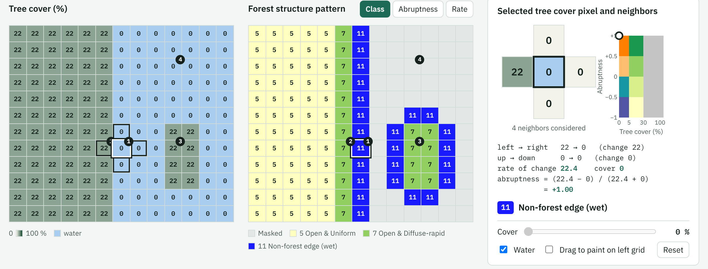

The taiga-tundra ecotone (TTE) map classifies the cold edge of the boreal forest by the *pattern* of its tree cover, not just the amount ([Montesano et al. 2020](https://doi.org/10.1088/1748-9326/abb2c7)). Each 30 m pixel gets a class from two numbers: its tree canopy cover, and its **abruptness**, which compares how fast cover changes around the pixel with how much cover it has.

Those classes are easy to state but harder to picture on a map, so I built a small interactive guide.

**[Open the TTE map interpretation guide ↗](https://pahbs.github.io/tte/docs/tte_interpretation_guide.html)**

## How it works

Choose one of nine conceptual landscapes (gradual and rapid treelines, sharp edges, tree islands, gaps in forest, thin lines of trees, a checkerboard, a lakeshore). Each one is drawn as a grid of tree cover pixels next to the forest structure pattern classes the map would give them. Select any pixel, or move with the arrow keys, to see:

- **Its four neighbours** and the rate of change in cover across them, computed like a terrain slope with cover in place of elevation.
- **Its abruptness**, `(rate − cover) / (rate + cover)`, from −1 (uniform) to +1 (abrupt), with every step of the arithmetic shown.
- **Its class**, placed on a small tree cover × abruptness chart of the 11 classes.

You can also change a pixel's cover, mark it as water, or paint on the grid to build your own landscape.

## Things it makes visible

In a gradual treeline, cover falls by the same 3 % per pixel, so the rate of change is nearly constant. The classes still change across it, because the cover that rate is compared with keeps shrinking: the same slope reads as *Open & Uniform* at 27 % cover and *Sparse & Diffuse-rapid* at 3 %.

Water is set to 0 % cover before anything is calculated, so a lakeshore looks like a forest edge (*Non-forest edge, wet*), and a small wooded island is edge almost everywhere. Open water away from trees has no change around it and is masked out.

## Where it fits

The guide sits alongside the code in the [tte](https://github.com/pahbs/tte) repository, which now reproduces the original Google Earth Engine TTE workflow in Python on NASA's [MAAP](https://maap-project.org/), and runs with any tree canopy cover raster as input.
