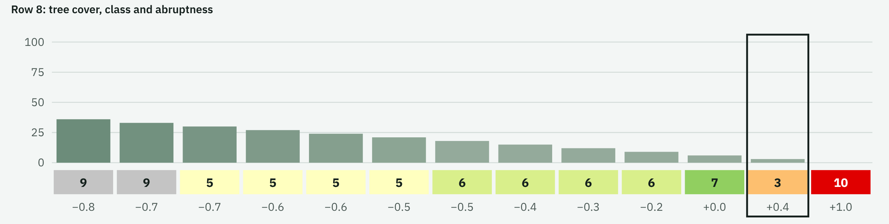
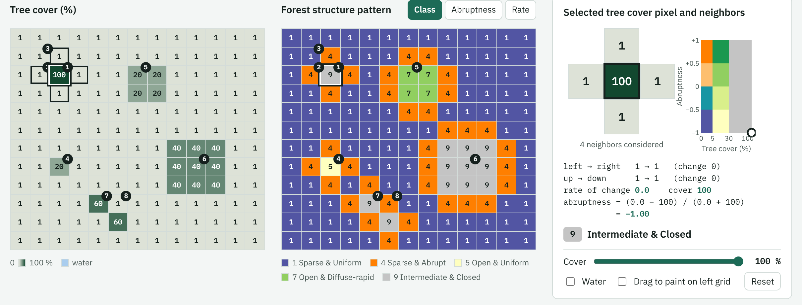

The taiga-tundra ecotone (TTE) map classifies the cold edge of the boreal forest by the *pattern* of its tree cover, not just the amount ([Montesano et al. 2020](https://doi.org/10.1088/1748-9326/abb2c7)). Each 30 m pixel gets a class from two numbers: its tree canopy cover, and its **abruptness**, which compares how fast cover changes around the pixel with how much cover it has.

Those classes are easy to state but harder to picture on a map, so I built a small interactive guide.

**[Open the TTE map interpretation guide ↗](https://pahbs.github.io/tte/docs/tte_interpretation_guide.html)**

## How this guide works

Our map describing the pattern and extent of the circumpolar taiga-tundra ecotone has a fairly unruly set of classes. To improve understanding of ecotone forest patterns and help with interpretation this interactive guide to the map's classification explains how various ecotone forest patterns are classified in our map. Choose one of nine conceptual ecotone landscapes (gradual and rapid treelines, sharp edges, tree islands, gaps in forest, thin lines of trees, a checkerboard, a lakeshore). Each one is drawn as a grid of tree cover pixels next to the forest structure pattern classes the map would give them. Select any pixel, or move with the arrow keys, to see:

- **Its four neighbors** and the rate of change in cover across them, computed like a terrain slope with cover in place of elevation.
- **Its abruptness**, `(rate − cover) / (rate + cover)`, from −1 (uniform) to +1 (abrupt), with every step of the arithmetic shown.
- **Its class**, placed on a small tree cover × abruptness chart of the 11 classes.

You can also change a pixel's cover, mark it as water, or paint on the grid to build your own landscape.

## What this guide reveals

In a gradual treeline, cover falls by the same 3 % per pixel, so the rate of change is nearly constant. The classes still change across it, because the cover that rate is compared with keeps shrinking: the same slope reads as *Open & Uniform* at 27 % cover and *Sparse & Diffuse-rapid* at 3 %.

Tree islands, patches of trees in 1 % cover, show the opposite surprise: the pixel *with* the trees can be the most uniform one on the map. A lone 100 % pixel has matching neighbors left and right and up and down, so its rate of change is 0 and its abruptness is −1, the minimum. Its four side neighbors take the change instead, at +0.97, so the island appears as a plus sign of *Sparse & Abrupt* around an *Intermediate & Closed* center. The middle of a 3 × 3 patch is uniform for the same reason, and a 1 % pixel wedged between two dense pixels gets a high rate because dense cover sits on two of its sides.

## Where it fits

The guide sits alongside the code in the [tte](https://github.com/pahbs/tte) repository, which now reproduces the original Google Earth Engine TTE workflow in Python on NASA's [MAAP](https://maap-project.org/), and runs with any tree canopy cover raster as input.
